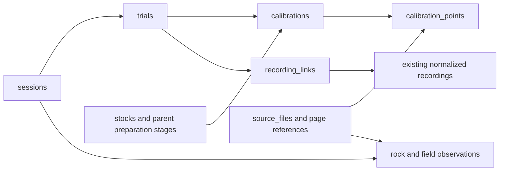

# Field-data schema

## Current compact salt interface: October 14

The maintained input layout is four UTF-8 CSVs under `salt_dilution/data/records/`. The [records guide](../salt_dilution/data/records/README.md) describes the populated local dataset, provenance and remaining review. It currently contains 38 physical releases, 43 calibration attempts, 262 observed point rows and 42 association/placeholder rows. The broader October 12 transcription below remains intact as staging evidence.

| Table | Grain | Key |
| --- | --- | --- |
| `trials.csv` | One physical release | `trial_id` |
| `calibrations.csv` | One preparation or attempt | `calibration_id` |
| `calibration_points.csv` | One reading in a calibration/probe series | `calibration_id`, `probe_alias`, `step_no` |
| `trial_inputs.csv` | One candidate release/recording/probe/channel/window/calibration association; unresolved placeholders explicitly marked | References `trial_id` and optional `calibration_id`; direct `dataset_id`/`processed_path` |

Keep the agreed compact headers:

```text
trials.csv
trial_id,site_alias,field_date,trial_label,sourcebook_reference,injection_form,salt_mass_g,injection_solution_volume_ml,dump_timestamp_utc

calibrations.csv
calibration_id,field_date,site_alias,procedure_id,stock_water_source,stock_salt_mass_g,stock_water_initial_ml,stock_solution_final_ml,injectate_aliquot_ml,secondary_water_initial_ml,calibration_water_initial_ml,sourcebook_reference,review_status

calibration_points.csv
calibration_id,step_no,probe_alias,recorded_added_volume_ml,addition_kind,recorded_vessel_volume_ml,actual_conductivity_us_cm,specific_conductivity_us_cm,temperature_c,sourcebook_reference,review_status

trial_inputs.csv
trial_id,dataset_id,processed_path,calibration_id,probe_alias,recording_role,window_start_utc,window_end_utc,conductivity_basis,review_status
```

Field dates are local ISO dates. All UTC event/window fields currently remain blank. `site_alias` is `NISQ` or `PAR`, with an empty alias for unresolved supporting calibrations. `injection_form` is `dry` or `solution` when established. `addition_kind` is `incremental`, `cumulative` or `unconfirmed`. `stock_water_source` is `river` or `deionized` when established; otherwise blank. `conductivity_basis` is `actual` or `specific` when selected. Review states are `unreviewed`, `needs_review` or `verified`; the initial population uses `needs_review` throughout.

Use the existing [procedure profiles](../salt_dilution/config/procedure_versions.json): `solution_secondary`, `mass_stock_river` and `mass_stock_deionized`. Unknown or unsupported preparations keep a blank procedure; a date cannot select it. Initial water is not final stock volume, mass of water is not volume, and nominal salt mass is not an accepted delivered mass. Full preparation stages and quantity bases remain in the local companion provenance.

Written additions are stored without replacing them by a calculated cumulative series. Uncertain handwritten tokens retain blank numeric values and their original text in provenance. Do not promote crossed-out/empty rows or an abandoned preparation into an accepted fit. Keep original source positions in `step_no`, including gaps.

`trial_inputs.csv` contains eight evidence-backed recording candidates across seven files, with 34 unresolved-path rows. Every release has at least one row. A blank path preserves an unresolved notebook association; it is not a selected dataset. A populated path still needs scientific checks. Three historical dataset IDs were retained after exact timestamp/EC-series comparison, and four new identities are frozen in provenance. Same-day matching alone does not establish a link. Known cross-probe calibration candidates are documented in provenance rather than silently applied to another probe.

The four compact field tables, source provenance, manifest and validation report are versioned together. Large generated stream tables and metadata remain Git-ignored under `processed/`. The following section describes the older local staging layout; it is not an additional set of tables required by a future compact runner.

## Preserved October 12 transcription

Use UTF-8 CSV tables with lowercase `snake_case` columns, stable text IDs, ISO field dates, and units in numeric column names. This schema connects handwritten calibration/injection records to normalized instrument exports and supporting sediment observations. It preserves the existing `raw/ -> processed/ -> results/` boundary.

The first local transcription is at `salt_dilution/data/processed/field_notes/2026-10-12/`. Its `README.md`, `table_schema.json`, `manifest.json` and `review_issues.csv` describe its actual coverage. It contains unreviewed measurements, not accepted calibration fits or computed discharge. Field-data bundles stay local under the existing processed-data ignore rule.

## Folder organization

```text
salt_dilution/data/
├── examples/                      Preserved historical examples
├── raw/                           Original exports; existing paths retained
│   └── YYYYMMDD/
│       ├── Logs/                  When present in the source
│       └── LiveReadings/          When present in the source
└── processed/
    ├── YYYYMMDD/                  Existing normalized exports + metadata
    └── field_notes/
        └── 2026-10-12/
            ├── README.md
            ├── sessions.csv
            ├── source_files.csv
            ├── page_coverage.csv
            ├── field_observations.csv
            ├── review_issues.csv
            ├── table_schema.json
            ├── manifest.json
            ├── validation_report.json
            ├── discharge/
            │   ├── trials.csv
            │   ├── stocks.csv
            │   ├── calibrations.csv
            │   ├── calibration_points.csv
            │   ├── instrument_assignments.csv
            │   ├── recordings.csv
            │   ├── recording_links.csv
            │   ├── calibration_file_links.csv
            │   └── cross_section_points.csv
            ├── sediment/
            │   └── rock_observations.csv
            └── seismic/
                └── impact_events.csv
```

The three category folders distinguish measurements with different physical meanings. Shared source/session/context tables sit above them. There is one table per record type, rather than a new folder or file for every trial. Preserve the bundle date as its transcription version. Keep future fitted factors, figures, integrated waves and discharge estimates under `salt_dilution/results/<run_id>/`.

## Record types and joins

| Table | One row represents | Key and relationship |
| --- | --- | --- |
| `sessions` | A field date and site alias used to group records | `session_id`; grouping alone does not establish constant flow or a matched experiment |
| `trials` | One physical salt release documented in the notes | `trial_id -> session_id` |
| `stocks` | One preparation stage | `stock_id`; a secondary dilution can reference `parent_stock_id` and its aliquot |
| `calibrations` | One calibration attempt, including a restart or rejected attempt | `calibration_id -> session_id`; optional `trial_id` and `stock_id` |
| `calibration_points` | One written addition/reading row | `point_id -> calibration_id`; `point_order` preserves the source sequence |
| `instrument_assignments` | One observed probe-role assignment | `assignment_id -> session_id`; raw identifiers and uncertainty retained |
| `recordings` | One already-normalized CSV and its metadata sidecar | `recording_id`; references files instead of duplicating logger readings |
| `recording_links` | One candidate trial/export association | `trial_id -> recording_id`; `selected` remains false until reviewed |
| `calibration_file_links` | One numeric comparison with an existing calibration CSV | `calibration_id`; agreement does not validate units or identity |
| `cross_section_points` | One station/depth entry in a flow-meter cross-section series | `cross_section_id` and `point_order`; original and corrected series remain separate |
| `rock_observations` | One written tethered-rock observation | `rock_observation_id -> session_id`; optional future `matched_discharge_trial_id` |
| `impact_events` | One controlled hammer strike | `impact_event_id`; `transect_id`, distance, strike order and literal time |
| `field_observations` | One supporting observation with its quantity and written unit | `observation_id -> session_id`; optional `trial_id` |
| `source_files` | One source PDF | `source_id`; original local path and SHA-256 |
| `page_coverage` | One inspected PDF spread | `source_id + source_page`; identifies exclusions and duplicates |
| `review_issues` | One specific unresolved reading, discrepancy or association | `issue_id`; target table, record and field identify the item to review |



An empty association is unresolved. Do not select a recording by date alone or join every rock observation to every salt dump from the same day. First confirm site/probe, clock alignment and the measurement windows. Record any accepted association explicitly.

The initial calibration-file comparison checks same-date, same-length tables with a `Conductivity` column. It compares each candidate handwritten channel using an absolute tolerance of 0.005 in the stored numeric units, without unit conversion. Full agreement requires every point to be present and agree; partial links retain the comparable/matching counts. This is reconciliation evidence only. The original and transcribed sources remain separate.

## Calibration values

`calibration_points` uses the same measurement names as normalized Aqua TROLL exports:

- `actual_conductivity_us_cm`
- `specific_conductivity_us_cm`
- `temperature_c`

Both conductivity channels may be present in a single point. Use the channel matching the field recording and accepted calibration method. The source unit still requires review when a page abbreviates it to “µS” or gives an ambiguous heading. A column name is a storage convention, not evidence of a verified physical unit.

Each point also retains `addition_ml_raw`, `mixture_volume_ml_raw` and raw conductivity/temperature tokens. Plain numeric readings populate numeric columns; uncertain or overwritten readings retain their candidate text with the numeric value empty. Original decimal text remains available in the raw columns.

`addition_semantics` is `cumulative`, `incremental`, or `unknown`:

- Cumulative records retain the written running total in `cumulative_ml`; the difference from the preceding known total supplies `increment_ml`.
- Incremental records retain the written individual addition in `increment_ml`; summing the known sequence supplies `cumulative_ml`.
- Unknown semantics leave both derived fields empty. Missing/uncertain increments interrupt the derived sequence. Crossed-out rows are retained and excluded from those derived quantities.

These are volume bookkeeping operations. No concentration or calibration regression is implied. The October 4 round-2 annotation is represented as increments `0, 2, 6, 6, 6, 6, 6, 6, 4, 4`, ending at 46 mL. Written mixture-volume disagreements are review issues, not automatic corrections.

Stock preparation distinguishes `salt_mass_g`, `starting_water_ml`, `starting_water_mass_g`, `parent_aliquot_ml`, and `measured_final_solution_ml`. Starting water is not a measured final solution volume. A mass of DI water is not silently converted into a volume. Unknown preparation stages remain incomplete records rather than inheriting another day's recipe.

The `method_family` values describe the intended calculation context: `relative_concentration`, `mass_stock`, or `unspecified`. They do not identify an implemented calculation. A later fitted factor must state its definition, axis direction, units, conductivity basis and diagnostics. It must not be confused with an instrument cell constant.

## Salt releases and clocks

`trials` separates nominal salt mass, preparation water, reserved sample, reported injection volume and actually delivered mass/volume. Delivery fields remain empty where a spill, ambiguous volume basis, or incomplete mixing prevents establishing the quantity. Historical “dry” and “solution” labels remain source labels; `injection_method` records a slug.

`field_date` is the field date, never the transcription date. `injection_time_raw`, `time_raw` and `timezone_label_raw` preserve the source clock notation. A clearly readable clock can populate `injection_time_local` without assigning an offset. UTC fields stay empty until instrument clocks and the literal “PST”/“PDT” labels are reconciled. Existing logger timestamps remain in their original normalized CSVs.

## Sediment and other measurements

`apparatus_distance_m` stores a readable tether/reel-associated observation. `distance_raw` preserves “nothing,” overwritten values and other shorthand. A written numeric zero is `observed_zero`; “nothing” is `written_nothing` with the numeric field empty. No movement speed or natural bedload flux is derived.

`rock_label` resolves an explicit within-block ditto. `rock_id` remains empty where physical identity across blocks/dates is not established. Repeated source round labels remain distinct source blocks. `release_duration_s` is populated only from explicit durations; a note about one-minute intervals does not automatically become a one-minute release duration.

`cross_section_points` retains written feet and source series. The supplied depth tables lack the complete paired velocity record needed to independently recompute velocity-area discharge. Reported instrument discharge totals are stored as `field_observations` with quantity `reported_discharge` and unit `cfs`.

`impact_events` retains source times and distances. The undated node-09 transect has no invented date from its facing page. Radio-test geometry, rock characterization, backgrounds, peaks, width/depth and local velocity notes live in the supporting observations table. Air-quality instructions are outside this scientific dataset.

## Loading alongside current exports

The new bundle is already structured data. Load its CSVs directly; `read_data()` remains the reader for original instrument/legacy calibration formats and does not dispatch these relational tables.

```python
from pathlib import Path
import pandas as pd

bundle = Path("salt_dilution/data/processed/field_notes/2026-10-12")
points = pd.read_csv(bundle / "discharge/calibration_points.csv")
calibrations = pd.read_csv(bundle / "discharge/calibrations.csv")
calibration_inputs = points.merge(
    calibrations, on="calibration_id", validate="many_to_one",
    suffixes=("_point", "_attempt"),
)

recordings = pd.read_csv(bundle / "discharge/recordings.csv")
links = pd.read_csv(bundle / "discharge/recording_links.csv")
# Review and select associations before loading/joining a recording's observations.
```

Do not concatenate this bundle with every logger CSV: points, releases, depth observations and high-frequency conductivity readings have different grains. Accepted file associations should connect them while preserving the original observation tables. The existing raw exports and their paths remain intact.

## Review and calculation readiness

The initial transcription has `review_status=unreviewed` and `analysis_ready=false`. Structural checks verify keys, source references, row counts, critical addition bookkeeping and preservation hashes. They do not verify every handwritten digit.

Review a complete calibration/release pair first: check the handwriting, units, stock stages, receiving volume, addition semantics, instrument/channel, injected quantity and clocks. Resolve relevant entries in `review_issues.csv`, recording the correction and reviewer without deleting the original token. Only then promote the accepted records for a calculation. Calibration and mass-slug processing remain separate work in `scripts/processing/`.
