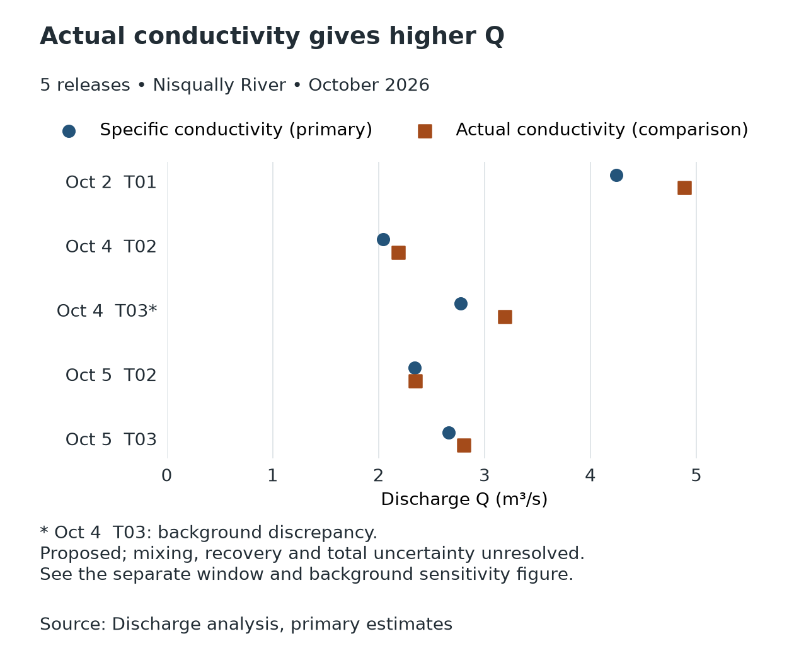
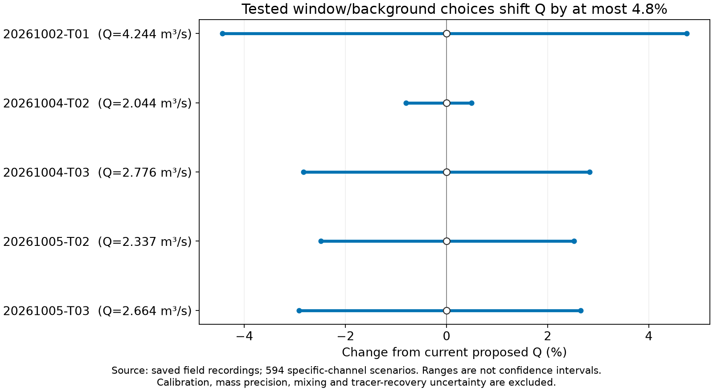
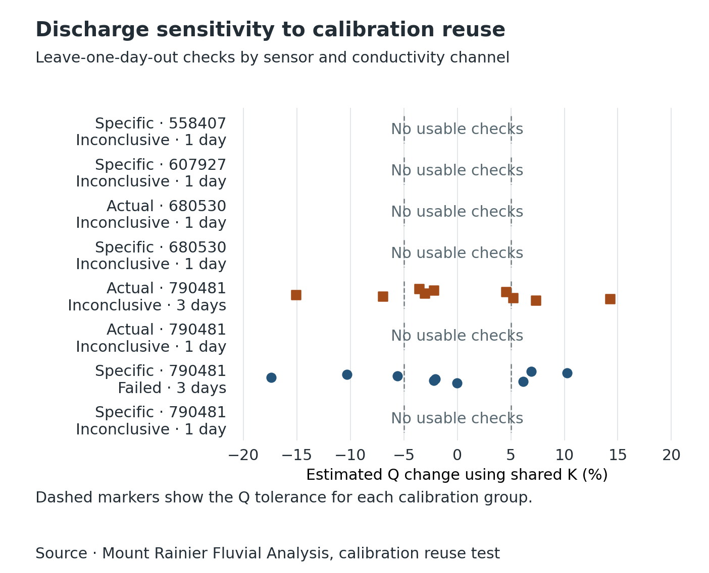

# Analysis results

The recovery run fitted **59 of 86 calibration series**. The [calibration review](discharge_analysis/tables/calibration_quality.csv) records fit quality, source variants and reasons for the 27 skips. The [October 26 probe review](calibrations/2026-10-26_probe_review/README.md) is the earlier 49-fit, 37-skip baseline.

## Discharge results

The [release table](discharge_analysis/tables/discharge_by_release.csv) covers **38 releases**. It contains five proposed Nisqually estimates with confirmed 4 kg deliveries and six conditional Paradise estimates. The Paradise values use the collaborator worksheet calibration and assume the nominal mass entered the river. Their nominal dose and the differences between the worksheet and notebook remain material uncertainties.

Primary Q is blank for 27 releases, including two practice releases. The historical solution-slug route was evaluated, and the release and recording tables retain its outstanding delivery, calibration, or capture requirements. October 4 T04 has a separate observed-interval scenario, yielding 3.676 m³/s from specific conductivity and 3.769 m³/s from actual conductivity. Both values assume the full tracer passage occurred within the observed interval and the initial background stayed constant. See the [conditional scenario table](discharge_analysis/tables/conditional_discharge.csv).

October 4 T03 retains a source discrepancy. The notebook lists a specific-conductivity background of 45 µS/cm, while the matched recording averages 26.36 µS/cm before the pulse. The transcribed and recorded peaks agree closely. The [field-note comparison](discharge_analysis/tables/field_note_comparison.csv) preserves the measurements used for the flag.

The observed-window ranges cover tested choices of pulse edges and background. Field mixing, tracer recovery and total measurement uncertainty remain open. Specific-channel reuse fails the ±5% Q criterion for the nine October calibration sessions across three days. Actual-channel reuse is inconclusive. See the [reuse evaluation](discharge_analysis/tables/coefficient_reuse.csv).

## Scenarios for missing information

The [working release table](discharge_scenarios/working_by_release.csv) gives conditional Q estimates for **22 additional Nisqually releases**. Recipes follow each trial's records and reviewed nominal settings, shared preparations, then preceding trials using the same protocol. The [parameter table](discharge_scenarios/working_parameters.csv) distinguishes recorded, confirmed, reviewed nominal and inferred quantities, with source references and donor ages. It does not turn an inferred value into a field measurement.

Together with the five previously selected Nisqually estimates, **27 of 30 experimental Nisqually releases have selected or working Q estimates**; two practice releases are excluded. The two July 9 releases retain competing stock-stage hypotheses. The September 3 spill has a per-litre response because the delivered volume is unknown. Its planned dose cannot establish the amount that entered the river.

The [working estimates](discharge_scenarios/working_estimates.csv) retain separate instruments, conductivity channels and calibration attempts. Some disagree substantially, so their minimum and maximum are not a confidence interval or a recommended average. Quantity, instrument, mixing and capture limitations remain attached to the results. None is scientifically accepted, and the original 11 selected estimates, including six Paradise releases, remain unchanged.

The full scenario package retains conditional alternatives for **24 additional releases**, plus the spill response, to show how recipe, volume, background and gap assumptions affect Q.

Some July 9 stock-stage alternatives produce implausibly large Q values. They remain diagnostic counterfactuals, not recommended estimates. The full minimum-to-maximum scenario range is not a plausible-discharge interval; inspect `recipe_evidence` and the source limitations for each alternative.

Use [scenario dispositions](discharge_scenarios/scenario_by_release.csv), [scenario estimates](discharge_scenarios/scenario_estimates.csv), [calibrations](discharge_scenarios/scenario_calibrations.csv) and [rejections](discharge_scenarios/scenario_rejections.csv) to compare those alternatives. The [settings](discharge_scenarios/scenario_settings.json) and [run record](discharge_scenarios/run_info.json) identify the assumptions and inputs. Volume and stock-stage alternatives are sensitivities, not measured quantities; endpoint gap models do not bound the missing pulse. See [methods](../../docs/research_methods.md#salt-dilution-measuring-water-discharge) and the [reproduction command](../../docs/getting_started.md#explore-discharge-assumptions).

## Use the analysis bundle

Start with the [all-release table](discharge_analysis/tables/discharge_by_release.csv) for estimates and reasons for blank Q. Blank Q means no selected estimate; separate capture-assumed scenarios are identified explicitly. The [primary table](discharge_analysis/tables/discharge_primary.csv) gives one selected estimate per release with a computed Q. Read `estimate_support` and the quality flags before using any value.

- The [remaining requirements](discharge_analysis/tables/recovery_requirements.csv) explain all 27 blank selected-Q values, separating quantity, calibration, instrument and capture evidence from the first pipeline stop. Two rows are practice releases.
- The [observed pulse areas](discharge_analysis/tables/observed_pulse_areas.csv) retain 16 channel integrals across seven releases. They are not discharge values. The August 6 excursion still has an unresolved release-time association.
- The [channel estimates](discharge_analysis/tables/discharge_estimates.csv) record 16 results with exact K references, windows, units and sensitivity components. Five are actual-conductivity comparisons for the Nisqually releases.
- The [channel review](discharge_analysis/tables/quality_review_by_channel.csv) gives the recomputed integral and diagnostics for each channel. Its `q_primary_m3_s` field gives that row's channel value. Use `estimate_role` to identify the selected estimate.
- The [bundle index](discharge_analysis/bundle_index.json) and [source manifest](discharge_analysis/run_info.json) give the export command, source references and hashes. The published tables and figures can be read directly. Rebuilding requires the local recordings and saved source runs. See the [export command](../../docs/getting_started.md#export-the-analysis-package).

### Graphs

[Individual pulse plots](discharge_analysis/figures/mass/pulses/) show the recorded conductivity, the selected integration windows, or the reason a recording did not yield a full-pulse estimate.

## Reproducing a calibration run

Use the [calibration runner](../../docs/calibration.md) with a fresh output directory. It writes the fitted series, derived points, skip reasons, figures and input/output hashes. The run record identifies the software versions and source inputs. Local MLflow is supplementary.

## Other runs

The [November 1 pairing baseline](matching/2026-11-01_reviewed_pairings/pairing_summary.csv) recorded 32 inferred proposals, one partial link, three conflicts and two practice exclusions. The [earlier source-linked bundle](matching/2026-11-01_source_linked_pairings/pairing_summary.csv) recorded 17 proposals. These were pairing checks under the evidence available at the time. See the [pairing guide](../../docs/getting_started.md#pair-releases-recordings-and-k-fits) for the current workflow.

The previous discharge handoff reported five proposed Nisqually values and left 33 release rows blank. The current package occupies the stable `discharge_analysis/` path. Selected calibration, pairing and discharge bundles are versioned. Intermediate runs, normalized recordings and local MLflow remain local.
