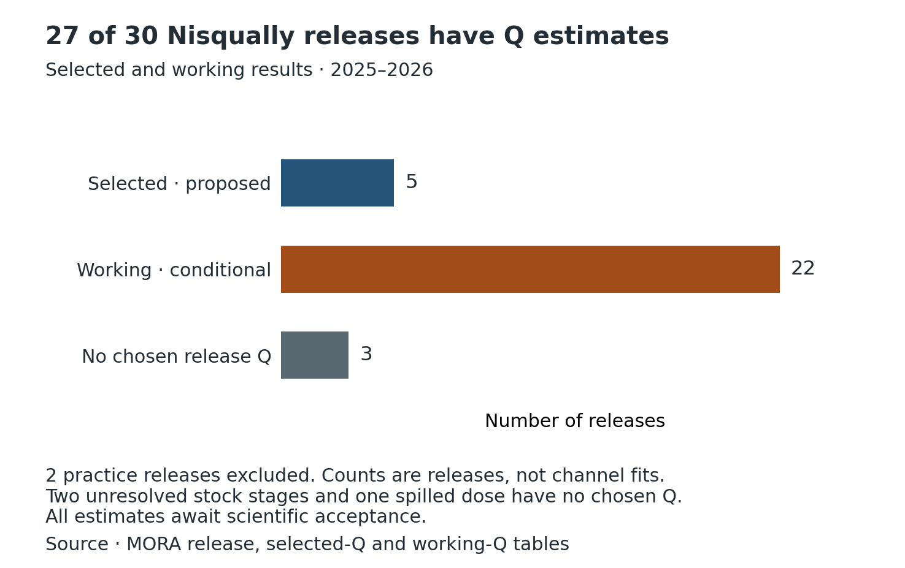
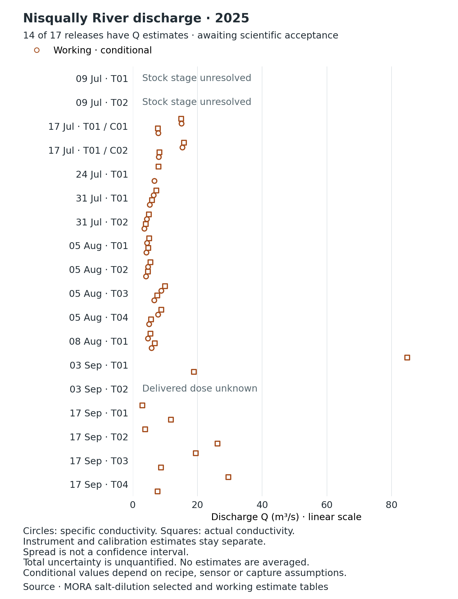
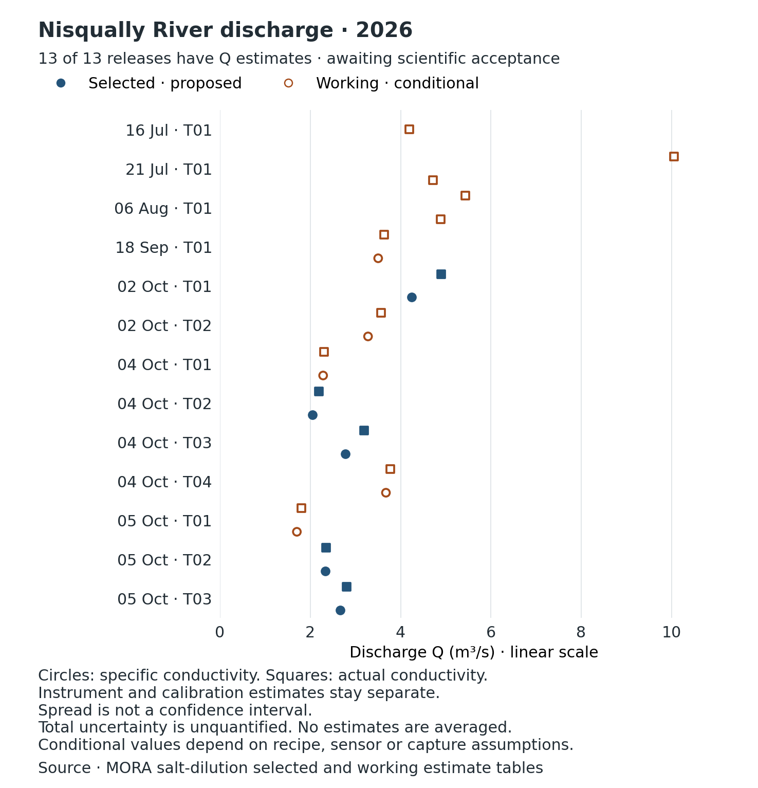
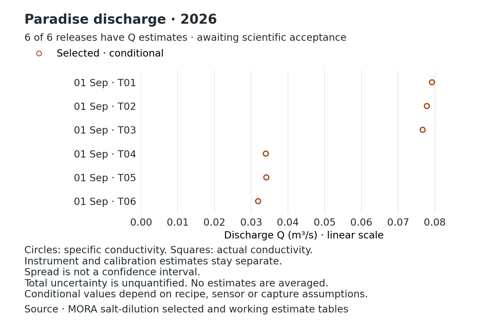

# Analysis results

**Q estimates are available for 33 of 36 experimental releases:** 27 of 30 Nisqually releases and all six Paradise releases. Two practice releases are excluded. This includes 22 Nisqually releases with conditional working estimates; all estimates retain their scientific limitations.

Use the [combined Q table](discharge_scenarios/figures/plot_estimates.csv) and the graphs below for current coverage. The [release coverage table](discharge_scenarios/figures/release_coverage.csv) includes every release, including those without a chosen Q.

The [CSV lineage diagrams](discharge_scenarios/README.md#how-the-csvs-fit-together) show how calibration, recordings and dose feed the working estimates, and how those estimates combine with the selected results. The [Python walkthrough](../notebooks/salt_slug_discharge_walkthrough.ipynb) reproduces a Nisqually estimate from its calibration and recorded salt pulse.

Start with the [compact reader tables](reader_tables/README.md) for release results, calibration fits, Q calculations, and sensitivity comparisons. Their guide links to the full calculation and provenance tables.

The `discharge_analysis/` folder preserves the selected-run baseline. Its tables and pulse plots do **not** include the 22 later working estimates: “No selected Q” there can coexist with a conditional Q in `discharge_scenarios/`. The [current pulse plots](discharge_scenarios/figures/by_trial/) contain both selected and working estimates in one place; their [recording/channel index](discharge_scenarios/figures/figure_index.csv) identifies the source of each value.

## Graphs

[Compare trials on the same field day](discharge_scenarios/figures/by_day/). Start with [Nisqually, October 4](discharge_scenarios/figures/by_day/nisq_2026-10-04_trials.png) or [Paradise, September 1](discharge_scenarios/figures/by_day/par_2026-09-01_trials.png). The panels use shared scales within each conductivity channel.

The [July 9 comparison](discharge_scenarios/figures/by_day/nisq_2025-07-09_trials.png) shows observed conductivity for both trials. The [diagnostic areas](discharge_scenarios/figures/day_diagnostic_traces.csv) can be calculated from the recordings while the calibration stock and delivered volume remain unresolved.

The comparisons include all **79 saved channel/calibration Q values**: 16 from the selected results and 63 from the 22 working releases. They use separate linear scales by site and year. No values are averaged, and the two per-litre spill responses are excluded from discharge comparisons. The [plotted data](discharge_scenarios/figures/plot_estimates.csv) identify each point's instrument, recording, channel, calibration and source table; the [figure index](discharge_scenarios/figures/figure_index.csv) links the pulse plots to their exact inputs.





The [July–August detail view](discharge_scenarios/figures/nisq_2025_early_detail.png) shows the earlier values on a narrower scale without removing the full-year view.





The [77 current pulse plots](discharge_scenarios/figures/by_trial/) include 16 selected-result plots and 61 working plots. They show conductivity, background windows, integrated areas and the available Q values. The July 31 gap is visibly modelled, and the two spill plots state their per-litre units instead of Q. Multiple calibration values may share one pulse plot. [Baseline pulse diagnostics](discharge_analysis/figures/mass/pulses/), [selected-estimate window sensitivity](discharge_analysis/figures/review/window_background_sensitivity.png) and [coefficient-reuse diagnostics](discharge_analysis/figures/reuse/calibration_consistency.png) remain available for their original scope.

The [figure run record](discharge_scenarios/figures/run_info.json) pins the source data and outputs. See the [reproduction command](../../docs/getting_started.md#regenerate-the-current-discharge-graphs).

## Downstream monitoring

The [recording audit](discharge_scenarios/figures/downstream/recording_audit.csv) covers 17 candidate source files, including the two native formats of one Aqua TROLL record. Workbook sessions use the dates and times inside the measurements. The table flags repeated samples from earlier sessions and one unsupported file. The role column records filename evidence. Blank reach and release fields identify associations still awaiting field evidence.

The [release-time coverage figure](discharge_scenarios/figures/downstream/general_recording_coverage.png) compares written release times with the date-labelled General exports. [Trial clock review](discharge_scenarios/figures/downstream/trial_clock_review.csv) lists the notebook page and Aqua TROLL links for each comparison. Some exports also contain sessions from dates other than the filename, so coverage in this figure is limited to the date-labelled files.

The [candidate pair table](discharge_scenarios/figures/downstream/candidate_pairs.csv) identifies five plausible same-release associations on river left. [August 8](discharge_scenarios/figures/downstream/nisq_2025-08-08_recording_alignment.png) has one written release followed by a distinct rise and fall in Aqua TROLL 790481 and General1. On September 17, Aqua TROLL 680530 and General1 show repeated pulses in the [morning](discharge_scenarios/figures/downstream/nisq_2025-09-17_am_recording_alignment.png) and [afternoon](discharge_scenarios/figures/downstream/nisq_2025-09-17_pm_recording_alignment.png). The afternoon notebook page records a move farther downstream than usual. It does not specify General1’s position relative to Aqua TROLL 680530.

Each trace panel uses its own vertical scale and the source clock. General retains the logged `uS` label because the measurement basis and compensation are unknown. The [data download SOP](../data/raw/README_Dilution_Data_Download_SOP.txt) describes `attenuation` as a location and purpose label, and the bank as a separate field. A filename supplies evidence of purpose but cannot establish longitudinal order for an individual release. The candidate associations support field review. Clock alignment, station order and channel comparability must be established before estimating travel time or attenuation.

The [September 3 diagnostic](discharge_scenarios/figures/downstream/nisq_2025-09-03_recording_alignment.png) and its [trace table](discharge_scenarios/figures/downstream/pilot_traces.csv) preserve the spill trial comparison. The [downstream run record](discharge_scenarios/figures/downstream/run_info.json) pins the input and output files. To reproduce from the pinned local matching run and processed Aqua TROLL files, use:

```sh
python -m salt_dilution.scripts.processing.audit_downstream_pulses \
  --matching salt_dilution/results/matching/2026-11-10_recovery_v4 \
  --output <fresh-output-directory>
```

## Discharge results

This section describes the preserved selected-run baseline. Read it alongside the working estimates below.

The [release table](discharge_analysis/tables/discharge_by_release.csv) covers **38 releases**. It contains five proposed Nisqually estimates with confirmed 4 kg deliveries and six conditional Paradise estimates. The Paradise values use the collaborator worksheet calibration and assume the nominal mass entered the river. Their nominal dose and the differences between the worksheet and notebook remain material uncertainties.

In this baseline table, primary Q is blank for 27 releases, including two practice releases; 22 of those blanks now have separate working estimates. The historical solution-slug route was evaluated, and the release and recording tables retain its outstanding delivery, calibration, or capture requirements. October 4 T04 has a separate observed-interval scenario, yielding 3.676 m³/s from specific conductivity and 3.769 m³/s from actual conductivity. Both values assume the full tracer passage occurred within the observed interval and the initial background stayed constant. See the [conditional scenario table](discharge_analysis/tables/conditional_discharge.csv).

October 4 T03 retains a source discrepancy. The notebook lists a specific-conductivity background of 45 µS/cm, while the matched recording averages 26.36 µS/cm before the pulse. The transcribed and recorded peaks agree closely. The [field-note comparison](discharge_analysis/tables/field_note_comparison.csv) preserves the measurements used for the flag.

The observed-window ranges cover tested choices of pulse edges and background. Field mixing, tracer recovery and total measurement uncertainty remain open. Specific-channel reuse fails the ±5% Q criterion for the nine October calibration sessions across three days. Actual-channel reuse is inconclusive. See the [reuse evaluation](discharge_analysis/tables/coefficient_reuse.csv).

## Scenarios for missing information

The [working release table](discharge_scenarios/working_by_release.csv) gives conditional Q estimates for **22 additional Nisqually releases**. Calibration and dose assumptions follow each trial's records and reviewed nominal quantities first, then shared preparations, then earlier trials using the same protocol. The [parameter table](discharge_scenarios/working_parameters.csv) distinguishes recorded, confirmed, reviewed nominal and inferred values. It lists sources and how many days earlier each supporting trial occurred.

Together with the five previously selected Nisqually estimates, **27 of 30 experimental Nisqually releases have selected or working Q estimates**; two practice releases are excluded. How the calibration stock was prepared remains unclear for the two July 9 releases. The September 3 spill has a per-litre response because the delivered volume is unknown. Its planned dose cannot establish the amount that entered the river.

The [working estimates](discharge_scenarios/working_estimates.csv) retain separate instruments, conductivity channels and calibration attempts. Some disagree substantially, so their minimum and maximum are not a confidence interval or a recommended average. Quantity, instrument, mixing and capture limitations remain attached to the results. None is scientifically accepted, and the original 11 selected estimates, including six Paradise releases, remain unchanged.

The full scenario package retains conditional alternatives for **24 additional releases**, plus the spill response, to show how stock preparation, injected volume, background and gaps in the pulse affect Q.

Some July 9 stock assumptions produce implausibly large Q values. Use them to assess sensitivity to stock preparation. The scenario range spans the assumptions tested. Check `recipe_evidence` and the source limitations before interpreting any value.

Use [scenario dispositions](discharge_scenarios/scenario_by_release.csv), [scenario estimates](discharge_scenarios/scenario_estimates.csv), [calibrations](discharge_scenarios/scenario_calibrations.csv) and [rejections](discharge_scenarios/scenario_rejections.csv) to compare those alternatives. The [settings](discharge_scenarios/scenario_settings.json) and [run record](discharge_scenarios/run_info.json) identify the assumptions and inputs. Volume and stock alternatives show how assumptions affect Q. Models based on the ends of a gap give no guaranteed bounds on the missing pulse. See [methods](../../docs/research_methods.md#salt-dilution-measuring-water-discharge) and the [reproduction command](../../docs/getting_started.md#explore-discharge-assumptions).

## Use the analysis bundle

Use the [baseline release table](discharge_analysis/tables/discharge_by_release.csv) to inspect the original selected estimates and their exclusions. Blank Q means no selected estimate; separate capture-assumed scenarios are identified explicitly. The [primary table](discharge_analysis/tables/discharge_primary.csv) gives one selected estimate per release with a computed Q. Read `estimate_support` and the quality flags before using any value.

- The [baseline requirements](discharge_analysis/tables/recovery_requirements.csv) explain its 27 blank selected-Q values, separating quantity, calibration, instrument and capture evidence from the first pipeline stop. Two rows are practice releases.
- The [observed pulse areas](discharge_analysis/tables/observed_pulse_areas.csv) retain 16 channel integrals across seven releases. They are not discharge values. The August 6 excursion still has an unresolved release-time association.
- The [channel estimates](discharge_analysis/tables/discharge_estimates.csv) record 16 results with exact K references, windows, units and sensitivity components. Five are actual-conductivity comparisons for the Nisqually releases.
- The [channel review](discharge_analysis/tables/quality_review_by_channel.csv) gives the recomputed integral and diagnostics for each channel. Its `q_primary_m3_s` field gives that row's channel value. Use `estimate_role` to identify the selected estimate.
- The [bundle index](discharge_analysis/bundle_index.json) and [source manifest](discharge_analysis/run_info.json) give the export command, source references and hashes. The published tables and figures can be read directly. Rebuilding requires the local recordings and saved source runs. See the [export command](../../docs/getting_started.md#export-the-analysis-package).

## Reproducing a calibration run

The recovery run fitted **59 of 86 calibration series**. The [calibration review](discharge_analysis/tables/calibration_quality.csv) records fit quality, source variants and reasons for the 27 skips. The [October 26 probe review](calibrations/2026-10-26_probe_review/README.md) is the earlier 49-fit, 37-skip baseline.

Use the [calibration runner](../../docs/calibration.md) with a fresh output directory. It writes the fitted series, derived points, skip reasons, figures and input/output hashes. The run record identifies the software versions and source inputs. Local MLflow is supplementary.

## Other runs

The [November 1 pairing baseline](matching/2026-11-01_reviewed_pairings/pairing_summary.csv) recorded 32 inferred proposals, one partial link, three conflicts and two practice exclusions. The [earlier source-linked bundle](matching/2026-11-01_source_linked_pairings/pairing_summary.csv) recorded 17 proposals. These were pairing checks under the evidence available at the time. See the [pairing guide](../../docs/getting_started.md#pair-releases-recordings-and-k-fits) for the current workflow.

The previous discharge handoff reported five proposed Nisqually values and left 33 release rows blank. The selected-run baseline occupies `discharge_analysis/`; later working estimates and combined graphs occupy `discharge_scenarios/`. Selected calibration, pairing and discharge bundles are versioned. Intermediate runs, normalized recordings and local MLflow remain local.
