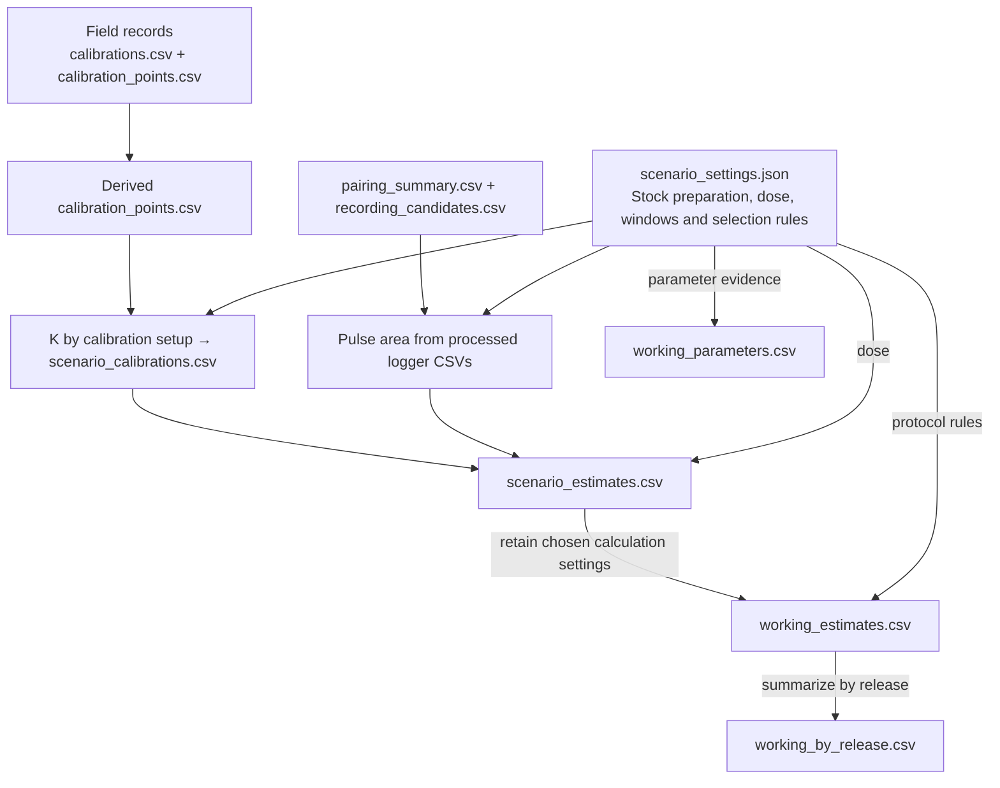
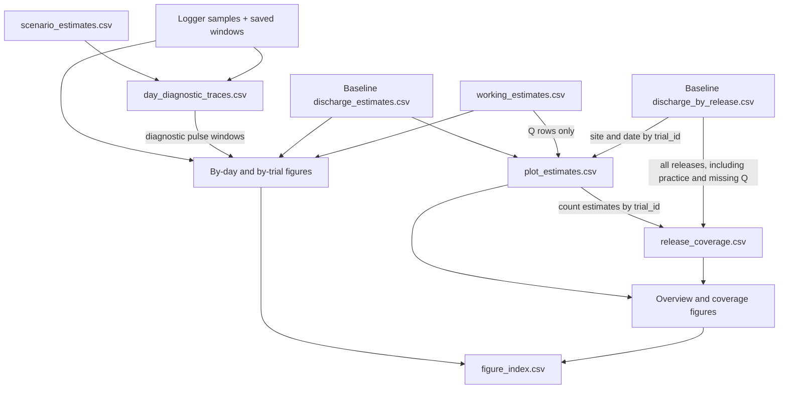

# Salt-discharge results and scenarios

Start with [figures/plot_estimates.csv](figures/plot_estimates.csv) for the combined Q results. It contains **79 instrument/channel/calibration estimates across 33 experimental releases**. Use [figures/release_coverage.csv](figures/release_coverage.csv) to see all 38 recorded releases: 33 with Q, three without a chosen Q, and two excluded practice releases.

This folder holds the additional conditional calculations and the current combined graphs. The original selected calculations remain in [discharge_analysis](../discharge_analysis/README.md). Together they cover **27 of 30 experimental Nisqually releases and all six Paradise releases**. “Selected” and “working” describe how an estimate was retained; neither means scientific acceptance.

## Which file should I open?

- **Compare Q or count releases with Q** in the [combined estimates](figures/plot_estimates.csv) and [coverage table](figures/release_coverage.csv).
- **Check K, dose and pulse area** in the [working estimates](working_estimates.csv) or [selected estimates](../discharge_analysis/tables/discharge_estimates.csv). The combined table's `source_table` field tells you which one to use.
- **Check a dose assumption or compare alternatives** in the [working parameters](working_parameters.csv) and [scenario estimates](scenario_estimates.csv).
- **Read fewer columns** in the [compact tables](../reader_tables/README.md).

## How the CSVs fit together

### From field data to working discharge

The scenario runner fits K for each calibration preparation and conductivity channel. It subtracts background from the recording and integrates the signed conductivity excess over the pulse window. Multiplying that area by the K for the same channel gives the time integral of added salt concentration or original solution fraction. Divide the delivered salt mass or solution volume by its corresponding integral and convert to m³/s.

The diagram shows how values flow within the scenario run. The runner writes the scenario fits and estimates together, then applies the saved protocol rules to retain working rows. It writes `working_parameters.csv` from those rules as a record of where each input came from. The [baseline release table](../discharge_analysis/tables/discharge_by_release.csv) defines which experimental releases need scenarios, and [recovery requirements](../discharge_analysis/tables/recovery_requirements.csv) carry the outstanding limitations. `scenario_by_release.csv` summarizes all tested alternatives. `scenario_rejections.csv` records exclusions and failed calculations.

### From saved discharge to figures

The plot runner keeps each saved estimate separate and omits the two per-litre spill responses from `plot_estimates.csv`. The summary comparisons use the combined Q rows. Day and trial pulse figures also need the conductivity samples and saved windows to draw the curves. Diagnostic windows can show a pulse even when no Q was chosen.

## CSV guide

Counts below describe the saved package. A **release** is one physical injection. An **estimate** is a calculation for a particular recording, conductivity channel, calibration and set of assumptions. Several estimates can belong to one release.

The `recipe_id` field identifies the calibration preparation and dose used in a calculation. The `window_id` field identifies the background and salt-pulse intervals.

### Combined results and graph references

| File | One row represents | What it provides |
| --- | --- | --- |
| [figures/plot_estimates.csv](figures/plot_estimates.csv) | One plotted Q estimate; **79 rows** | Q in `q_m3_s`, date, site, instrument, calibration, status and source table. Combines 16 selected-result rows with 63 working-result rows. It excludes per-litre spill responses and releases without a chosen Q. |
| [figures/release_coverage.csv](figures/release_coverage.csv) | One release; **38 rows** | `plot_status` and `plotted_q_count`. Includes missing and practice cases, making this the appropriate table for coverage counts. It does not contain Q magnitudes. |
| [figures/figure_index.csv](figures/figure_index.csv) | A figure entry, day-to-trial link, or estimate-to-pulse link | Image path, figure kind, and the trial, recording, channel, calibration and window IDs where applicable. Repeated paths link an image to multiple trials or calculations. |
| [figures/day_diagnostic_traces.csv](figures/day_diagnostic_traces.csv) | One observed pulse window per trial, recording and channel without a chosen discharge estimate | The signed conductivity area in µS/cm × seconds, the background method and the capture status. |

In `plot_estimates.csv`, `status` distinguishes `selected_proposed`, `selected_conditional` and `working_conditional`. In `release_coverage.csv`, `no_chosen_q` identifies the three unresolved releases; `excluded_practice` identifies the two practice releases.

### Working calculations

These three files cover the **25 experimental Nisqually releases without Q in the original selected-results table**. They do not repeat the original 11 releases with selected estimates.

| File | One row represents | What it provides |
| --- | --- | --- |
| [working_by_release.csv](working_by_release.csv) | One release; **25 rows** | Calculation choices, estimate counts and remaining limitations. There are 22 releases with conditional Q, two with unresolved stock preparation, and one with only a per-litre response. `working_q_min_m3_s` and `working_q_max_m3_s` summarize the retained estimates for that release. |
| [working_estimates.csv](working_estimates.csv) | One retained calculation; **65 rows** | Full quantities, K, integration results, Q and assumptions. There are 63 Q rows across 22 releases and two per-litre response rows for the spill release. Separate instruments, channels and calibration attempts are retained. |
| [working_parameters.csv](working_parameters.csv) | One parameter decision for a release, optionally a particular calibration; **98 rows** | `field`, `value`, `unit`, the decision's `basis` and `reason`, source references, and preceding trials used as evidence. Match `used_by_working_recipes` to `recipe_id` to find which setups use the value. |

Use trial records and reviewed nominal values first, then shared preparations, then earlier trials at the same site, in the same year, and under the same protocol. A method change ends that precedent. The saved settings specify how to handle the background and gaps. The evidence behind each input determines which results are retained.

`parameter_source_status` distinguishes **recorded**, **participant_confirmed**, **reviewed_nominal**, **inferred** and **unresolved** values. Read `basis` and `reason` as well: a recorded nominal dose is not necessarily a measured delivered dose. `donor_ids` identifies preceding records, and `donor_age_days` gives their age relative to the target trial. An inferred quantity remains an assumption.

### Sensitivity experiments

These files retain the broader set of tested alternatives from which the working results were drawn. They are useful for examining how an assumption changes Q, rather than adding more independent field observations.

| File | One row represents | What it provides |
| --- | --- | --- |
| [scenario_by_release.csv](scenario_by_release.csv) | One release; **25 rows** | Counts of tested preparations, pulse windows and results, the full Q range, and remaining evidence gaps. Twenty-four releases have numerical Q scenarios and one has per-litre responses. This is broader coverage than the working selection. |
| [scenario_estimates.csv](scenario_estimates.csv) | One calculation; **398 rows** | The calibration, dose, recording, pulse window, background and gap treatment for 392 conditional Q results and six per-litre responses. Use it to compare alternatives within a release. |
| [scenario_calibrations.csv](scenario_calibrations.csv) | One fit under a tested preparation; **80 rows** | K, its fit standard error, units, point count, R² and the fitted conductivity range. One fit can support several pulse integrations. |
| [scenario_rejections.csv](scenario_rejections.csv) | One excluded candidate or failed calculation attempt; **3 rows** | The affected calculation or window, `stage` and `reason`. The saved exclusions are one abandoned calibration and two incomplete recordings. Use `release_coverage.csv` to find releases with no chosen Q. |

The two July 9, 2025 releases have numerical alternatives in `scenario_estimates.csv` but no chosen Q because stock preparation is unresolved. Some stock assumptions produce implausibly large Q. Neither the full scenario range nor the working minimum/maximum is a confidence interval or an instruction to average the values.

## Reading the calculation columns

The detailed estimate tables share the following field groups. The working table adds `working_recipe_status`, `protocol_source_decisions`, `protocol_exceptions` and `working_choice_is_measurement` to preserve the working-selection decision.

| Fields | Meaning and units |
| --- | --- |
| `q_m3_s` | Discharge Q in **m³/s**. Multiply by 1,000 for L/s. Blank does not mean zero flow. |
| `q_m3_s_per_delivered_litre`, `result_class` | A unit response for the spill case. When `result_class` is `unit_response`, `q_m3_s` is blank. The response could be multiplied by a known delivered volume in litres; the planned volume does not establish the spilled release's actual delivery. |
| `mass_g`, `injection_solution_volume_ml`, `quantity_kind` | The dose used by the applicable mass or original-solution-volume method. The unused quantity can be blank. These are calculation inputs; read their recorded or assumed basis before treating them as delivered measurements. |
| `k`, `k_se`, `coefficient_unit` | The concentration-per-conductivity coefficient and its fit standard error. Units are either `(mg/L) / (uS/cm)` or `(mL/mL) / (uS/cm)`. These coefficients serve different calculation methods and cannot be pooled as one quantity. |
| `n_points`, `r_squared`, `ec_min`, `ec_max`, `fit_note` | Calibration fit diagnostics. The conductivity range is in µS/cm. K standard error measures fit precision only. Stock preparation, delivered quantity and other field uncertainties are separate. |
| `dose_fraction_slope`, `concentration_scale`, `secondary_fraction` | Intermediate calibration terms. K is the dose-fraction slope multiplied by the concentration scale; that scale already includes any secondary dilution fraction. |
| `integral_us_cm_s`, `observed_interval_integral_us_cm_s`, `modelled_gap_integral_us_cm_s` | Total integrated excess conductivity and its observed/modelled components, in **µS/cm × seconds**. A modelled component is not an additional sensor observation. |
| `background_mode`, `background_pre_us_cm`, `background_post_us_cm` | The selected background treatment and background conductivity in µS/cm. `pre` or `post` uses that background; `linear` interpolates between the two. |
| `gap_mode`, `modelled_gap_seconds`, `in_pulse_gap_count`, `gap_interpretation` | Whether and how a gap enters the integration. Read these before comparing a fully observed pulse with an estimate that models missing samples. |
| `pre_samples`, `pulse_samples`, `post_samples`, duration and peak fields | Sensor observations and intervals supporting integration, distinct from calibration-point counts. Durations are seconds; `pulse_peak_us_cm` is conductivity in µS/cm. |
| `recipe_assumptions`, `capture_assumptions`, `sensor_applicability`, `event_link_status`, limitation and issue fields | Qualifications concerning preparation, full pulse capture, sensor transfer, event association and data quality. Keep these attached when exporting or comparing Q. |

`conductivity_basis` distinguishes **actual** conductivity from temperature-compensated **specific** conductivity. Use the matching channel's K. `sensor_serial` identifies the recording instrument; calibration aliases are series labels and do not independently establish physical sensor identity.

All saved `scientifically_accepted` values are false. `selected_for_primary` and `working_choice_is_measurement` likewise do not promote the working estimates into accepted field measurements. Fit errors and tested scenario ranges do not quantify total Q uncertainty.

## Follow a Q value back to its source

The `source_table` field in `figures/plot_estimates.csv` resolves as follows:

| Stored value | Detailed table |
| --- | --- |
| `working_estimates.csv` | [working_estimates.csv](working_estimates.csv) in this folder |
| `tables/discharge_estimates.csv` | [discharge_analysis/tables/discharge_estimates.csv](../discharge_analysis/tables/discharge_estimates.csv) in the sibling baseline folder |

For example, filter the combined table to **`NISQ-20261004-T01`**, specific conductivity. Its conditional Q is **2.285 m³/s** when rounded. The matching working row records calibration `NISQ-20261004-C01`, `recipe_id` `NISQ-20261004-T01:NISQ-20261004-C01:scenario_01`, and window `window_021`. That row supplies the 4,000 g dose, K ≈ 0.366499 `(mg/L) / (µS/cm)` and integrated excess conductivity ≈ 4,777.400 µS/cm × seconds. Its capture status still assumes the recorded interval contains the full pulse.

To trace any working result:

1. Find its detailed row using `trial_id`, `recording_edge_id`, `conductivity_basis`, `calibration_id`, `calibration_series_alias`, `window_id` and `recipe_id`.
2. Read the corresponding parameter decisions and their `used_by_working_recipes` lists in `working_parameters.csv`.
3. Find the preparation and dose under `cases[].recipes[]` and the pulse window under `windows[]` in [scenario_settings.json](scenario_settings.json). Windows define the pre-background, pulse and optional post-background intervals. Field clock times use the confirmed fixed **PST, UTC−08:00** interpretation.
4. Use the same IDs in `figures/figure_index.csv` to open the pulse graph. The example above is [window 021, specific conductivity](figures/by_trial/NISQ-20261004-T01_window_021_specific.png).

For joins, keep the full estimate identity: `trial_id` alone will multiply rows across sensors, channels and assumptions. When matching a working row to `scenario_estimates.csv`, also include `background_mode` and `gap_mode`. To join `working_estimates.csv` or `scenario_estimates.csv` to `scenario_calibrations.csv`, use `trial_id`, `recipe_id`, `calibration_id`, conductivity basis and the calibration-series label; that label is named `calibration_series_alias` in the estimate tables and `probe_alias` in the calibration table.

For the original selected results, `recipe_id` and `window_id` in the combined table are blank. Use the trial, recording, channel and calibration IDs to reach the sibling source table, which stores its own `windows` and `fit_reference` details. Bring dates and sites into working-table analyses from `figures/release_coverage.csv` using its unique `trial_id`.

Cells containing lists or objects, such as `source_refs`, `donor_ids`, `recipe_assumptions` and `protocol_source_decisions`, contain JSON. Parse them as JSON rather than splitting on commas. Do not turn blank quantities or uncertainty fields into zero; for example, a two-point calibration fit cannot supply a residual-based slope standard error.

## Graphs, settings and reproduction

[figures/](figures/) contains five overview and coverage graphs, [77 individual pulse plots](figures/by_trial/), and [nine comparisons for days with multiple experimental releases](figures/by_day/). Individual pulse plots show 75 panels with Q and two with per-litre spill responses. Diagnostic figures retained under `discharge_analysis` describe the earlier selected run and may still say “No selected Q.”

The day figures use shaded areas to show signed conductivity relative to each recording's background. The dashed zero line marks that background. Each curve starts at its own saved pulse-window boundary, so compare pulse shapes here and use the recorded timestamps for travel time. Actual and specific conductivity have separate panels. Gaps remain open. Proposed and conditional values follow the saved estimate statuses. Where several values are shown, they come from separate recordings or calibration choices. The individual plots and tables give dose basis, gap treatment and limitations. The six Paradise releases span two reaches and different recorded doses.

The [July 9 day figure](figures/by_day/nisq_2025-07-09_trials.png) shows the measured pulses from both trials. The pale fill marks diagnostic windows with no chosen Q. The [diagnostic area table](figures/day_diagnostic_traces.csv) records the observed intervals using the saved linear background where available and the saved pre-pulse background otherwise. The first trial's diagnostic trace on probe 790478 ends before its tail settles.

Match day and trial plots by probe serial and conductivity basis. Day colors separate recordings, and the legend shows typical sample spacing. Working trial plots draw observed conductivity in blue and mark modeled gaps in orange. Samples recorded once a minute can look angular when connected. Finer sampling resolves more of the pulse, while calibration and pulse capture still determine how to interpret Q. One July 31 export contains `840058` in its filename and `790481` in its device header. The figures use the header serial.

For eight releases with both one-minute and one-second recordings, the sparse trial figures show the recorded points and a separate, finer panel for the same conductivity basis. The lower panel shows observed conductivity relative to its own background, with gaps left open. The Q in the heading belongs to the upper recording. Find the finer recording's full plot and its own estimate in the `companion_figure` column of the [figure index](figures/figure_index.csv).

The remaining experimental releases without a chosen Q are **July 9, 2025, T01 and T02** (unresolved stock-stage interpretations) and **September 3, 2025, T02** (unknown delivered volume after a spill).

| File | Purpose |
| --- | --- |
| [scenario_settings.json](scenario_settings.json) | Stock preparation, dose, windows, protocol choices, exclusions and source references. |
| [run_info.json](run_info.json) | Scenario/working run metadata, software versions, counts, and input/output hashes. |
| [historical_code.json](historical_code.json) | Recorded hashes and Git revisions identifying historical source code used by upstream bundles. |
| [figures/run_info.json](figures/run_info.json) | Separate metadata and hashes for the combined graph build. |
| [figures/historical_code.json](figures/historical_code.json) | Historical code references encountered when checking the graph build's inputs. |

The [scenario runner](../../scripts/processing/discharge_scenarios.py) produces the calculation tables; the [graph runner](../../scripts/processing/plot_discharge_working.py) combines the selected and working results without choosing new Q values. Follow the existing commands to [rebuild the scenarios](../../../docs/getting_started.md#explore-discharge-assumptions) or [regenerate the graphs](../../../docs/getting_started.md#regenerate-the-current-discharge-graphs). Use a fresh output directory and retain the pinned local recordings and source runs. Reading the published CSVs and PNGs does not require those local inputs.

See [research methods](../../../docs/research_methods.md#salt-dilution-measuring-water-discharge) for the equations and assumptions, and [references](../../../docs/references/README.md) for the scientific sources.
